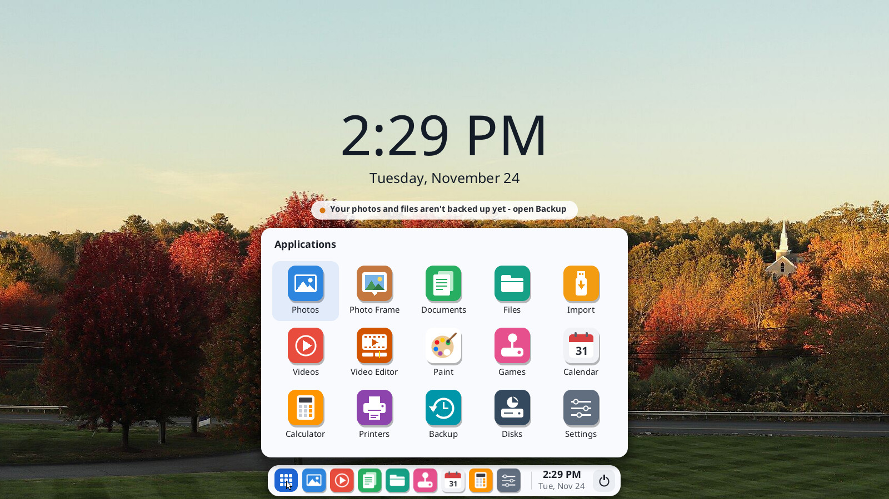
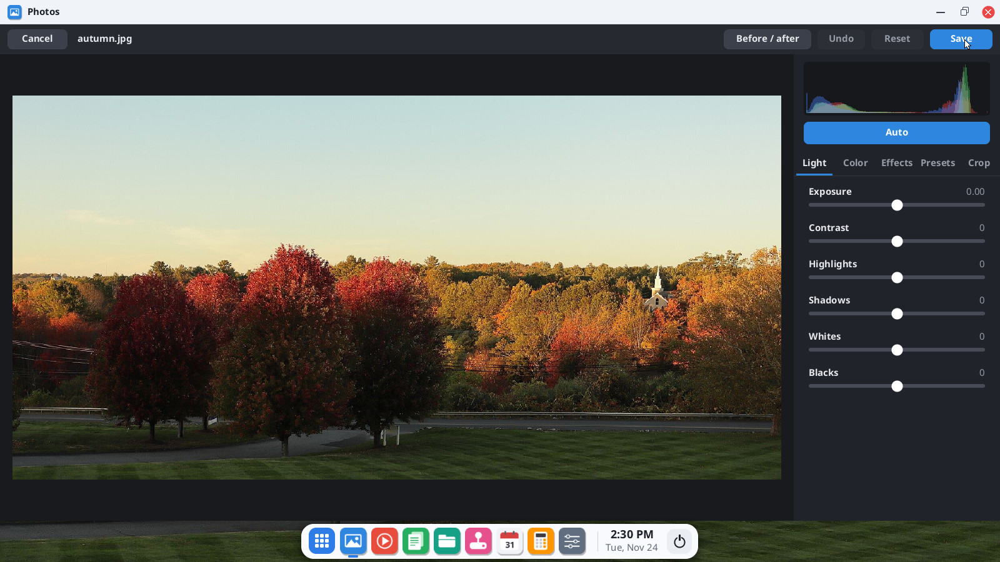
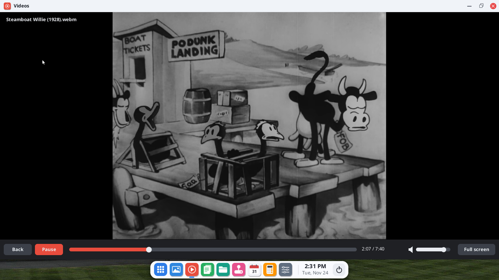
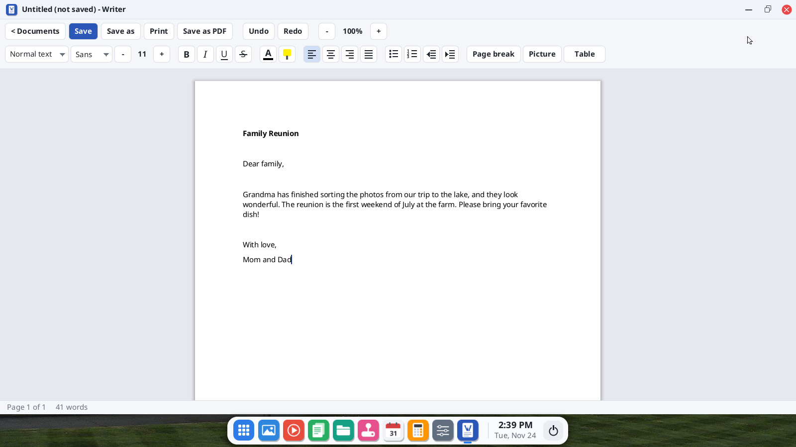
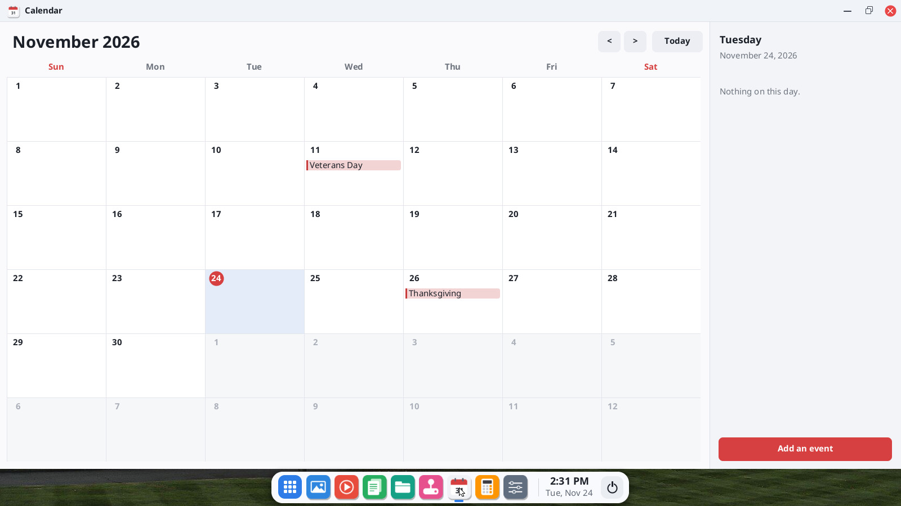
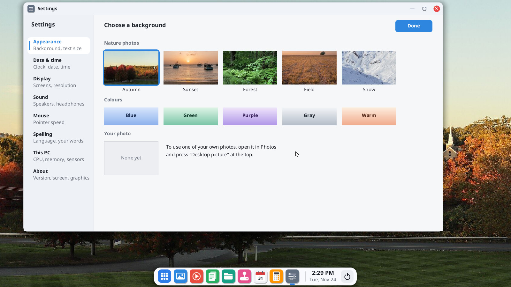
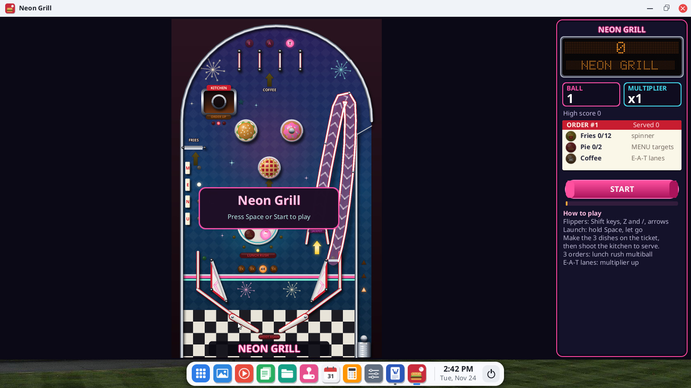
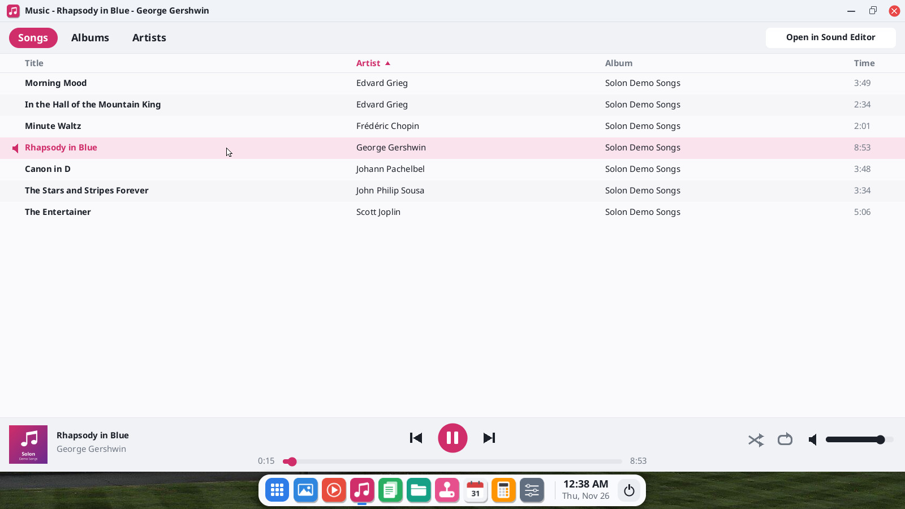
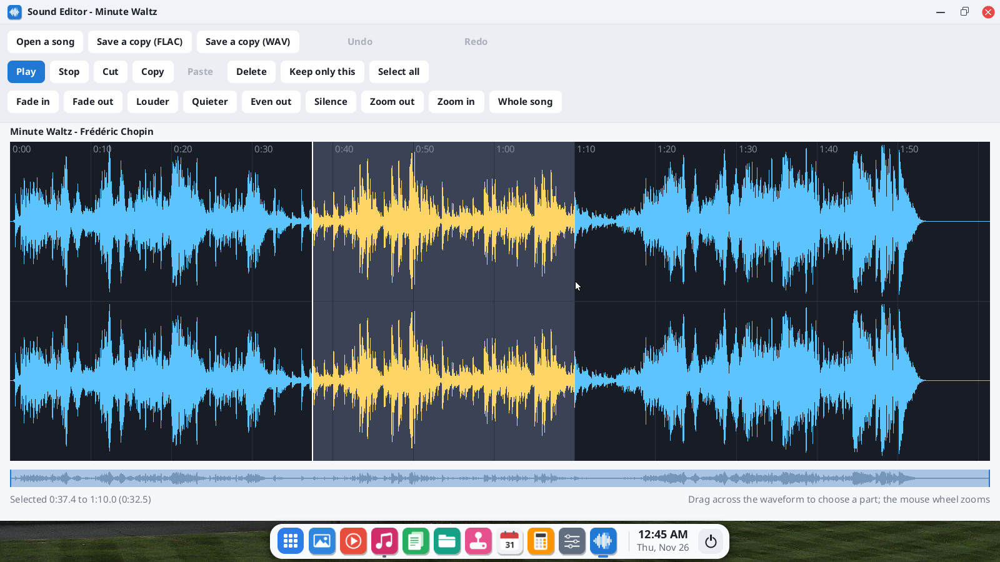

<h1 align="center">SimpleOS</h1>

<p align="center">
  <b>A calm, complete computer for the family.</b><br>
  Photos, documents, videos, music and games, with no internet, no accounts and no passwords.<br>
  An operating system written from scratch in Rust for 64-bit PCs.
</p>

<p align="center">
  <a href="https://github.com/PadenJohnson/SimpleOS/releases/tag/latest"></a>
  <a href="LICENSE"></a>
  
  
  
</p>

<p align="center">
  
</p>

SimpleOS began as an operating system for a family computer: somewhere for Grandma to keep
her photos and enjoy them, with nothing to log in to, nothing to download and nothing to
break. Everything stays on the computer, with real tools for photos, documents and videos,
plain enough for anyone, and careful with your files: nothing is changed or deleted without
asking, and a backup is one button. It starts from a USB stick and can be installed on the
PC's own disk. Inside the code it's called **Solon**.

## The idea

The idea of this OS is to be the most advanced while acceptable for people remembering the
past. Underneath, it uses today's hardware to the full: every processor core, its own
graphics drivers lighting a second monitor, every common photo and video format. On top, it
looks and works the way people already know computers: windows, a dock, folders, a big clock,
plain words instead of jargon, big clear text, and nothing that changes or asks for attention
by itself. New things arrive working, set up sensibly from the start (a second monitor simply
extends the desktop), with the choices in Settings for anyone who wants them.

## Screenshots

<table>
  <tr>
    <td width="50%"><br><b>Photos</b>: a Lightroom-style editor, with presets, crop and before/after</td>
    <td width="50%"><br><b>Videos</b>: Steamboat Willie (1928), played by Solon's own VP9 decoder</td>
  </tr>
  <tr>
    <td><br><b>Writer</b>: letters and Word documents, with spelling</td>
    <td><br><b>Calendar</b>: holidays, birthdays and events, also shown under the desktop clock</td>
  </tr>
  <tr>
    <td><br><b>Settings</b>: plain choices, like the desktop picture</td>
    <td><br><b>Games</b>: Neon Grill, an original pinball table, plus Solitaire, FreeCell, Mines, Sudoku and a shooter</td>
  </tr>
  <tr>
    <td><br><b>Music</b>: songs, albums and covers, with seven public-domain classics to start</td>
    <td><br><b>Sound Editor</b>: trim, fade and even out a song, saved as a copy</td>
  </tr>
</table>

## Highlights

- **Photos at the heart of it.** Every common photo type (JPEG, PNG, iPhone HEIC, WebP, camera
  RAW and more), a Lightroom-style editor, a photo frame and screensaver, and printing in 4x6,
  5x7, Letter and A4.
- **Everyday documents.** Writer opens and saves Word files, Spreadsheets opens and saves Excel
  files, PDFs can be filled in, signed and combined, and spelling works everywhere you type.
- **Videos from phones, cameras and DVDs.** H.264, HEVC, VP9, MPEG-2 and more, with sound, all
  decoded by Solon itself and checked against FFmpeg; and a simple video editor that makes MP4s.
- **Music, with seven classics to start.** A music player for MP3, M4A, FLAC, Ogg, Opus, WAV
  and AIFF with albums, covers, shuffle and repeat, and a Sound Editor to trim, fade and
  even out songs. A new stick comes with public-domain recordings, from Joplin's The
  Entertainer to Gershwin himself playing Rhapsody in Blue in 1924.
- **Plug things in.** USB drives and SD cards, Android phones and iPhones, USB printers, and a
  second monitor that simply extends the desktop.
- **Careful with your files.** USB drives are only read unless you ask; deleting goes to a
  recycle bin; backups keep older versions; other systems' partitions are never touched.
- **Something to play.** Neon Grill Pinball and Starbase Breach (both original), Solitaire,
  FreeCell, Mines and Sudoku.
- **Today's hardware, used fully.** Every processor core (a video's pictures decode on a core
  of their own), the processor's floating-point and vector unit, all of the computer's memory,
  Solon's own NVIDIA RTX display driver, and sound through speakers, headphones, monitor
  speakers and USB headsets.
- **Laptops too.** The battery beside the clock (charge, time left, a warning when it runs
  low), read by running the laptop's own firmware code as Windows does, and internal disks
  in every SATA mode laptops ship with (AHCI, RAID and the older ATA/IDE mode).
- **Offline by design.** No network, no accounts, no ads, nothing collected, nothing to update
  from the internet. Updates come on a USB stick.

Everything, app by app: [docs/features.md](docs/features.md).

## Get started

1. Download **`solon.img`** from the [latest release](https://github.com/PadenJohnson/SimpleOS/releases/tag/latest).
   It's rebuilt and boot-tested automatically every time the code changes.
2. Write it to a USB stick with [Rufus](https://rufus.ie) (DD image mode) or
   [balenaEtcher](https://etcher.balena.io). This erases the stick; any size works, and 8 GB or
   more leaves room for photos.
3. Start the PC from the stick (the boot menu key at power-on, often F8, F11 or F12). Secure Boot
   can stay on: the first time, approve SimpleOS once in the blue shim screen.

Your photos and documents are kept on the stick itself, in a partition of its own. To keep
SimpleOS on the computer for good, open **Disks** and choose **Install Solon here**. The full
walk-through, with what to do if a PC won't start from the stick, is in
[docs/real-pc-guide.md](docs/real-pc-guide.md).

## Hardware

| Part | What works |
|---|---|
| Computers | 64-bit (x86-64) PCs with UEFI (Secure Boot on or off) or an older BIOS |
| Processors | Every core is used; on AMD Ryzen, the live clock, temperature and power |
| Graphics | Every Intel, AMD and NVIDIA card through the firmware's screen; on NVIDIA RTX 30 series cards, a second monitor through Solon's own driver |
| Disks | NVMe and SATA drives, USB drives and SD card readers (FAT and exFAT) |
| USB | USB 3 and USB 2 controllers, hubs, keyboards and mice, Android phones, iPhones and cameras |
| Printers | USB printers that speak IPP (AirPrint), PCL, PCL 6 or PostScript |
| Sound | HD Audio: speakers, headphones and optical out, and monitor speakers on NVIDIA RTX cards; USB headsets, speakers and headphones (USB Audio Class 1 and 2) |
| Sensors | Nuvoton NCT6798D and NCT6799D motherboard sensors: fans, temperatures and voltages |
| Network | None, on purpose |

Tried on real hardware so far: an AMD Ryzen 7 5800X on an ASUS ROG STRIX B550-F GAMING WIFI II
with an NVIDIA GeForce RTX 3080 and two monitors. Driver work is followed stage by stage in
[docs/graphics.md](docs/graphics.md) and [docs/hardware.md](docs/hardware.md).

## Building from source

You need Rust (the nightly toolchain is picked automatically from `rust-toolchain.toml`) and
QEMU with OVMF. On Linux, including a Raspberry Pi:

```sh
git clone https://github.com/PadenJohnson/SimpleOS.git
cd SimpleOS
git clone https://github.com/limine-bootloader/limine.git --branch=v9.x-binary --depth=1
./run.sh              # build and run it in a QEMU window
./test.sh --help      # headless tests that drive the mouse and keyboard and take screenshots
tools/make-usb.sh     # build dist/solon.img for a real PC
```

On Windows the same scripts end in `.ps1` (`.\run.ps1`, `.\test.ps1`,
`.\tools\make-usb.ps1`). [docs/development.md](docs/development.md) covers testing, boot
options, the host tools and the release hook.

## Repository layout

| Path | What it is |
|---|---|
| [`src/`](src) | The kernel: start-up, drivers, the desktop and every app, in Rust ([a map of it](src/README.md)) |
| [`docs/`](docs) | The feature list, guides for real PCs and for development, driver notes, screenshots |
| [`tools/`](tools) | The USB image builder, a disk image tool, and tests that check Solon's code against FFmpeg and others |
| [`assets/`](assets) | Built-in desktop photos (CC0) and the spelling dictionary |
| [`fonts/`](fonts) | Noto Sans and Noto Serif |
| [`secureboot/`](secureboot) | Secure Boot: shim, MokManager and how they're used |
| [`vendor/acpi/`](vendor/acpi) | The acpi crate (ACPI tables and the AML interpreter) with Solon's fixes ([what changed](vendor/acpi/README.solon.md)) |
| [`samples/`](samples) | Test photos for development |
| `run.sh`, `test.sh` | Run Solon in QEMU, and headless tests (`run.ps1`, `test.ps1` on Windows) |
| `Cargo.toml`, `build.rs`, `linker.ld`, `limine.conf` | The crate, its build script, the kernel's memory layout, the boot menu |
| `x86_64-solon.json` | Solon's build target: bare-metal x86-64 with the floating-point and vector unit in use |

## Credits

SimpleOS is built on:

- [Limine](https://github.com/limine-bootloader/limine), the boot loader, and
  [shim](https://github.com/rhboot/shim) for Secure Boot.
- [Noto](https://fonts.google.com/noto) fonts by Google (SIL Open Font License) and
  [SCOWL](http://wordlist.aspell.net/) word lists for spelling.
- Desktop photos released as CC0 by photographers on Wikimedia Commons
  ([credits](assets/wallpapers/CREDITS.md)).
- Demo songs in the public domain from Wikimedia Commons: the United States Marine Band and
  Air Force Band, Musopen, James Brigham (CC0), and Victor recordings by Sergei Rachmaninoff
  (1923) and Paul Whiteman's orchestra with George Gershwin (1924); the list is in
  `tools/make-demo-music.sh` and in CREDITS.txt next to the songs.
- Small Rust crates: limine, x86_64, spin, linked_list_allocator (for big blocks), zune-jpeg and zune-png,
  jpeg-encoder, miniz_oxide, ttf-parser, noto-sans-mono-bitmap and libm, and Isaac Woods'
  [acpi](https://github.com/rust-osdev/acpi) crate for running laptops' battery code.
- Laptop ACPI tables shared through the [Linux hardware database](https://github.com/linuxhw/ACPI),
  which the battery code is checked against.
- Reference: the [nouveau](https://nouveau.freedesktop.org/) project's work on NVIDIA hardware,
  Linux's drivers for how hardware behaves, and FFmpeg, which every decoder is checked against.

The video in the screenshots is Steamboat Willie (1928), public domain in the United States
since 2024.

## License

SimpleOS is free software under the [GNU General Public License v3.0](LICENSE).
